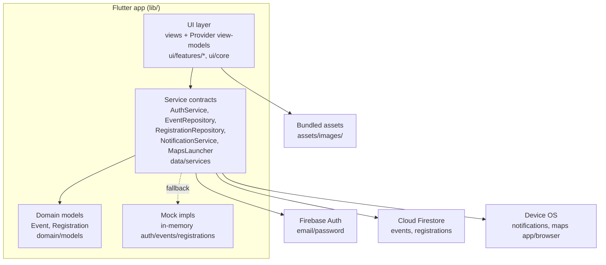
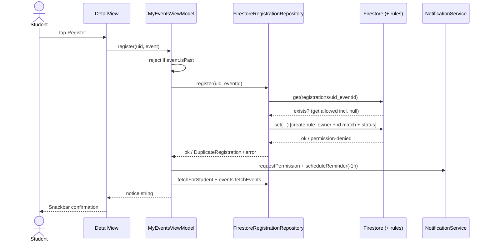
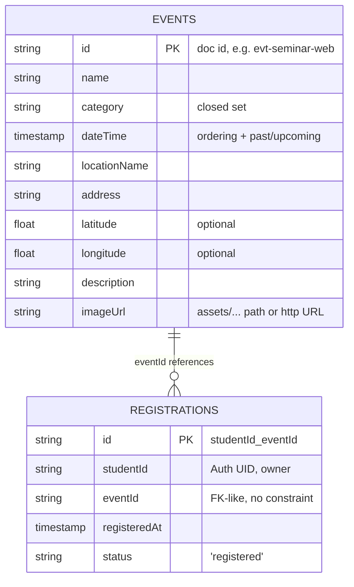

# DESIGN.md

> Technical architecture and design rationale of EventHub as implemented. This
> documents the system that exists — not a proposed redesign. See
> `CODEBASE_SUMMARY.md` for the file map and `SYSTEM_OVERVIEW.md` for
> workflows in plain language.

## 1. Design Overview

- **Style:** layered client-side app with repository abstraction. There is no
  app-owned backend: the "server" is Firebase (Auth + Firestore as BaaS) plus
  OS services. All business logic lives in the Flutter client.
- **Principles evident in code:** contract-first data layer (every service is an
  abstract class with swappable implementations, e.g.
  `lib/data/services/registration_repository.dart:6-14`); offline-capable
  development via in-memory mocks chosen at startup; user-facing errors as plain
  strings at the view-model boundary, never raw codes; best-effort device
  features (notifications, maps) that degrade without blocking core flows.
- **Boundaries:** `domain/models` (pure data, no Flutter imports except
  Firestore `Timestamp`) → `data/services` (I/O + platform) → `ui`
  (view-models hold state, views render). Views never touch Firestore/Auth
  directly — verified by import inspection.

## 2. Architecture Diagram

Only components that exist are shown. Firebase Storage is omitted deliberately:
the dependency is declared but no code path uses it.

## 3. Component and Responsibility Map

| Component | Responsibility / boundary | Depends on | Used by |
|---|---|---|---|
| `EventHubApp` / `AuthGate` / `HomeShell` (`main.dart`) | bootstrap, impl selection, route table, tab shell | all VMs, `firebase_options` | — (root) |
| `AuthViewModel` | UID state from auth stream; login/signup orchestration + error mapping | `AuthService` | `AuthGate`, `AuthView`, detail/my-events actions |
| `DiscoverViewModel` | live event list + in-memory category filter | `EventRepository` | `DiscoverView` |
| `MyEventsViewModel` | registrations⋈events join, upcoming/history split, register/cancel + reminder side effects | both repositories, `NotificationService` | `DiscoverView` (badges), `DetailView`, `RegistrationsList` |
| `EventCard` / `CategoryChips` / states (`ui/core/widgets.dart`) | shared presentation only, no I/O | `Event` | Discover, My Events, History |
| `EventHubTheme` | Sunny Day light/dark Material 3 tokens (orange primary, golden selected states, warm surfaces, green success) | Flutter SDK | `MaterialApp` |
| `ThemeController` | light/dark/system mode + sun-moon toggle, persisted via shared_preferences | `shared_preferences` | `MaterialApp.themeMode`, HomeShell + AuthView toggle buttons |
| Repositories (×2 impls each) | Firestore access *or* in-memory fakes behind one interface | Firestore SDK / nothing | view-models only |
| `MapsLauncher` | builds Maps URL, launches externally | `url_launcher` | `DetailView` |
| `CalendarLauncher` | Google Calendar template URL (documented 2h end fallback), external launch | `url_launcher` | `DetailView` |
| `confirmCancelRegistration` | shared cancel-confirm dialog (Sunny-themed, distinct Keep vs Cancel) | Flutter SDK | `DetailView`, `RegistrationsList` |
| `firestore.rules` | server-side authorization (auth-gated reads, owner-only registrations, deterministic-ID create rule) | Firebase platform | enforced on every Firestore call |

## 4. Request and Execution Lifecycle

A registration tap travels: gesture → view → view-model → repository →
Firestore → rules check → local reload → reminder → Snackbar. Reads are
fetch-then-render (My Events) or stream-then-render (Discover).

## 5. Frontend Design

- **Routing:** `home: AuthGate` + one generated route `/detail(eventId)`
  (`main.dart:73-87`). Tabs are local `_tab` state, not routes — deep linking
  to tabs/details is unsupported.
- **Hierarchy:** `EventHubApp → AuthGate → HomeShell → {DiscoverView,
  RegistrationsList ×2} → EventCard`; `DetailView` pushed modally-style via
  named route. Detail resolves its event by scanning already-loaded lists (no
  dedicated fetch) — an event missing from all lists renders "Event not found."
- **State:** three app-wide `ChangeNotifier`s; widgets `watch` for rebuilds,
  `read` for actions. Ephemeral UI state (tab index, password visibility,
  selected chip) is local `State`. One-shot messages use the `notice` +
  `takeNotice()` pattern (`my_events_view_model.dart:28,121-125`).
- **Forms:** `AuthView` — labeled fields, email keyboard type, password
  visibility toggle, autofill hints, inline validators, live-region error text.
- **API communication:** none directly — views call view-models, which call
  repositories; loading spinners, error + retry, and empty states cover every
  async list.
- **Frontend/backend boundary:** view-models are the boundary; repositories own
  all Firebase types (`Timestamp` conversion lives in model `fromMap`/`toMap`).

## 6. Backend Design

There is no custom backend. The backend *is* Firebase, configured not coded:

- **Init:** `Firebase.initializeApp(options: DefaultFirebaseOptions.currentPlatform)`
  (`main.dart:25-27`); per-platform values in `lib/firebase_options.dart`.
- **Controllers/services:** the repository classes act as the service layer;
  Firestore queries are the "endpoints" (`orderBy('dateTime')` events feed,
  `where('studentId'==uid)` registration queries).
- **No middleware, no background workers, no queues, no cron.** Reminder timing
  is delegated to the OS notification scheduler at registration time.
- **Mock backend:** `MockAuthService`, `MockEventRepository`
  (relative-date fixtures incl. one past event), `MockRegistrationRepository`
  — selected wholesale when Firebase init fails.

## 7. Data Architecture

Two collections, linked by plain ID reference (no Firestore references).

- **Ownership:** events are staff-owned (clients read-only); registrations are
  user-owned (create/read-own/delete-own, no update).
- **Consistency:** single-doc writes only — registration create is check-then-set
  (non-atomic; the deterministic ID + rules make double-create converge to one
  doc, with last-write-wins on fields). No multi-doc transactions anywhere.
- **Orphans:** registrations pointing at deleted events are skipped at join
  time (`my_events_view_model.dart:39-40`); no cascade or cleanup exists.

## 8. API Design

Not applicable — no app-owned endpoints. The Firestore surface used:

| Operation | Target | Rule |
|---|---|---|
| `snapshots/get orderBy dateTime` | `events` | signed-in |
| `query where studentId==uid` | `registrations` | per-doc owner check |
| `get` single registration | `registrations/{id}` | owner, or non-existent (duplicate check) |
| `set` registration | `registrations/{uid_eventId}` | owner + ID-match + `status=='registered'` |
| `delete` registration | `registrations/{id}` | owner |

Validation is client-side (forms, past-event guard) plus rules-side (ID shape,
status value). Error responses surface as `permission-denied` → user notices.

## 9. Security Architecture

- **Authentication:** Firebase email/password; UID is the identity primitive;
  session handled by the SDK; `AuthGate` hides all data UI when signed out.
- **Authorization:** Firestore rules (`firestore.rules`): events readable only
  when signed in, never writable by clients; registrations owner-scoped with
  `get`/`list` split so duplicate-check reads of missing docs succeed while
  listing stays per-doc owner-only; updates forbidden.
- **Implemented controls (verified):** per-student query filters, deterministic
  IDs, friendly error mapping (no code leakage), debug-only logging
  (`debugPrint`), secrets excluded from git (`google-services.json`,
  keystores, `.env` in `.gitignore`).
- **Missing/unverified:** no App Check; API-key referrer restrictions are a
  console setting, unverifiable from the repo; `firebase_options.dart` client
  keys are committed (safe by Firebase design — **Inferred** rationale, widely
  documented, not proven in-repo); `android:debuggable`/transport-security
  posture not audited (platform folders sampled only); notification bodies
  include event names (minor info exposure on lock screens).

## 10. External Systems and Integration Boundaries

- **Firebase Auth/Firestore:** HTTPS via SDK; no explicit timeouts/retries in
  code — SDK defaults apply; startup failure → mock fallback; mid-session
  failure → per-list error states. No offline-persistence tuning (SDK default).
- **OS notifications:** `zonedSchedule` with `inexactAllowWhileIdle`; past times
  skipped; cancel by hashed event ID; permission denial tolerated.
- **Maps:** fire-and-forget URL launch; boolean result drives a Snackbar.
- **Asset bundle:** compile-time; missing asset → Flutter error widget path in
  `errorBuilder`s (verified handlers in card + detail).

## 11. Error Handling and Observability

- **Propagation:** repository exceptions → view-model `notice`/error strings →
  Snackbars or inline text. `DetailView`/`RegistrationsList` always fall back to
  a generic message when `takeNotice()` is null.
- **Special cases:** `DuplicateRegistration` typed exception; legacy-rules
  `permission-denied` on pre-read tolerated in `register`
  (`registration_repository.dart:43-50`).
- **Logging/monitoring:** `debugPrint` only; no crash reporting, analytics,
  audit trail, or health checks exist (**Verified** by absence — no such
  imports or config found).

## 12. Configuration, Deployment, and Runtime

- **Runtime:** single flavor; Firebase options resolved per platform at launch;
  mock fallback if init fails. No environment files.
- **Build:** `flutter build web --release --base-href /mad-final-project/`
  (verified); `flutter build apk --debug` per README (not re-verified here).
- **Deploy:** manual — `build/web/` contents pushed to `gh-pages` branch;
  GitHub Pages serves the site; Firebase console must list the Pages domain
  under Auth authorized domains. No CI workflow exists in-repo (the earlier
  Actions experiment was removed; git history confirms).
- **Infra deps:** Firebase project `mad-project-83ad2`; GitHub repo
  `ralph-16/mad-final-project` with `master` + `gh-pages` branches.

## 13. Design Decisions and Trade-offs

| Decision (evidence) | Benefit | Trade-off |
|---|---|---|
| BaaS instead of custom server (no server code; repos call Firestore directly) | zero ops, fits school-project scope | all logic client-side; rules are the only server enforcement |
| Contract + mock per service (`*_service.dart`/`event_repository.dart`) | UI runs/tests run with zero setup | mock drift risk (e.g., mock dates are relative, Firestore dates absolute) |
| Deterministic registration IDs (`registration.dart:23-24` + rules) | duplicate guard without queries/transactions | ID embeds UID (minor Derby: doc IDs leak UIDs to anyone who can list — but listing is owner-scoped) |
| Bundled images over Storage (`pubspec.yaml:68-69`, `isAssetImage`) | offline, no Storage config/cost | new/changed photos require app release, not console edit |
| Sunny Day retheme centralized in `theme.dart` (no per-widget hex) | one-file palette changes, consistent light/dark | dark mode is a warm adaptation, not a separate design |
| Google-URL calendar export, no new deps (`calendar_launcher.dart`) | works Android/iOS/web today | Apple `.ics` unsupported; end time is a 2h fallback, not real data |
| Silent mock fallback (`main.dart:29-32`) | never a blank crash on misconfig | outages look like "no data" |
| Date-derived history (`isPast` + `_joined`) | no attendance system needed | timezone-sensitive; edge events near "now" can flip lists between loads |

## 14. Coupling, Complexity, and Technical Risks

- `MyEventsViewModel` is the most-coupled component (both repositories +
  notifications + join/sort logic) — the natural home of future registration
  bugs.
- `DetailView` depends on sibling view-models' cached lists rather than
  fetching — simple, but deep-linking or a stale cache yields "Event not
  found."
- Dead surface: `watchForStudent` and repo-level `isRegistered` are unused —
  either wire them (live My Events) or delete to reduce confusion.
- Single points of failure: the single Firebase project; the single
  `orderBy('dateTime')` query shape (a malformed event doc breaks the whole
  Discover feed parse? — **Unknown**: `fromMap` is null-tolerant per-field, so
  impact is likely degraded cards, not crashes, but unverified).
- Scale notes: per-student queries + client-side joins are fine at school
  scale; no pagination exists, so thousand-event catalogs would degrade
  Discover (accepted for MVP scope).

## 15. Extension and Change Guide

- **New event field:** add to `Event` + `fromMap`/`toMap` (`domain/models/event.dart:44-78`),
  render in `EventCard`/`DetailView`, backfill Firestore docs, update
  `tool/seed_events.json` shape note. Tests: extend widget test.
- **New registration rule (e.g., capacity):** enforce in `MyEventsViewModel.register`
  *and* `firestore.rules` (client-only checks are bypassable); add a unit test
  in `test/eventhub_test.dart` following the duplicate-guard pattern.
- **New screen:** add `lib/ui/features/<name>/{views,view_models}/`, register
  the VM in `main.dart:59-72`, route in `onGenerateRoute` (`main.dart:78-87`).
- **New image:** drop `.jpg` in `assets/images/`, reference as
  `assets/images/<name>.jpg` in the Firestore doc (no `pubspec` change needed —
  the whole dir is bundled).
- **Reminder policy change:** edit `reminderTimeFor`/`scheduleReminder`
  (`notification_service.dart`), keep the cancel pairing via `reminderIdFor`.

## 16. Architecture Questions and Recommendations

**Unresolved (need human decision):** keep or delete the unused
`watchForStudent`/repo-`isRegistered` APIs? Keep or remove the unused
`firebase_storage` dependency? Formalize `tool/seed_events.json` to the live
shape or delete it to stop mis-seeding? Add Firebase App Check + API-key
restrictions?

**Recommendations (impact-ordered, not implemented):**
1. Surface a visible "offline/mock mode" banner instead of silent fallback —
   kills the most confusing failure mode. (Medium effort.)
2. Reconcile or remove `seed_events.json` — prevents the most likely data-entry
   error. (Trivial.)
3. Wire `watchForStudent` into `MyEventsViewModel` (or delete it) — removes
   dead surface / gains realtime lists. (Small–medium.)
4. Add tests for `Event.fromMap` shapes + auth VM errors — cheapest coverage
   with real regression value. (Small.)

## 17. Evidence and References

Component claims cite the exact files/lines in §§3–15 (all repo-relative to
`mad_final_project/`). Diagrams reflect: layered client → Firebase + OS
services (§2); register sequence per `detail_view.dart` → `my_events_view_model.dart:70-104`
→ `registration_repository.dart:41-58` → rules (§4); ER per `Event.toMap`,
`Registration.toMap`, and `firestore.rules` (§7). Call-graph claims
(unused `watchForStudent`/repo-`isRegistered`) were verified by repository
search during analysis. Unexamined: live Firebase data, device runs,
`gh-pages` build output, most platform-native code.
